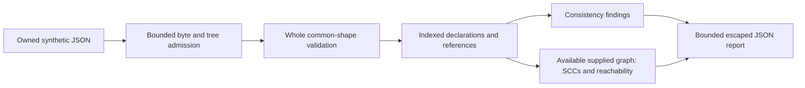

# Software Inventory Consistency Lab

An offline Python learning tool for checking **supplied synthetic declarations**: duplicate IDs, dangling/ambiguous references and disagreements with supplied identity/hash assertions. It also observes cycles and reachability in a well-defined supplied graph.

It implements the custom `inventory-lab/1` format. It does not validate CycloneDX/SPDX, discover software, hash artifacts, query vulnerabilities or certify completeness/authenticity/licensing. Consistent records can still omit any amount of real software. `synthetic: true` is a supplied flag, not proof that data is private-data-free.

## Run without installation

Requires trusted CPython; verified locally on Windows x64/CPython 3.13.7. Runtime uses only the standard library. From this directory:

```powershell
python -I lab.py examples/chain.json
python -I lab.py examples/cycle.json --output fresh-cycle-report.json
python -I lab.py examples/duplicate_references.json
```

Use only owned ordinary files containing invented fixture records and owned fresh report paths. No host/package/process discovery occurs. The last example exits 1 and preserves all duplicate/ambiguous reference evidence. `cycle.json` exits 0: a directed cycle is an allowed observation. `hash_mismatch.json` compares two declarations; neither identifies trusted bytes or a publisher.

Saved [chain report](examples/chain.report.json), [cycle report](examples/cycle.report.json), [ambiguous-reference report](examples/duplicate_references.report.json), [hash disagreement](examples/hash_mismatch.report.json), [unsupported profile](examples/unknown_schema.report.json) and [malformed unknown profile](examples/unknown_schema_bad_late.report.json) came from the actual CLI and match frozen expectations. They are JSON; no browser/service/UI is required.

## Input and interpretation

Exact root keys: schema/synthetic/components/edges/assertions/roots. Components declare id/name/version/sha256; assertions declare target/name/version/sha256; edges declare source/target. Hash is required but may be null. Other labels are 1–64 case-sensitive ASCII letters/digits/`.`/`_`/`+`/`-`. Required fields cannot be omitted; values never undergo normalization or version resolution. Full rules, state precedence and evidence fields: [CONTRACT.md](CONTRACT.md).

- IDs are local labels; every duplicate occurrence stays visible. No first/last record wins. An ambiguous component ID disables graph analysis.
- Supplied assertions compare literal name/version/hash values. Null/null means both have no hash declaration. Conflicting hashes under the same name/version are observations of different declarations, not proof of a bad package.
- Unknown and ambiguous references are reported independently at each source/target/root/assertion location. Unknown assertions alone do not disable an otherwise well-defined graph.
- Duplicate roots/edges are inconsistencies with indices and raw/unique counts. Mathematical traversal deduplicates them only after all references resolve.
- SCCs describe cycles, which are allowed. Roots-empty reachability is not requested. Not-reached nodes are only nodes not reached in the supplied graph, never proof they are unnecessary or an inventory is incomplete.
- A complete report means every admitted record was evaluated under this finite model. Completeness, authenticity, vulnerability absence and license compliance remain unknown.

## Architecture and API



`inventory_lab.model.evaluate(value)` accepts exact built-in ordinary values and returns a report without I/O/mutation. `evaluate_bytes(raw)` admits exact UTF-8 bytes. `inventory_lab.cli.serialize(report)` encodes an internally produced report; it is not admission for arbitrary report objects. Model imports/calls are inspected for excluded I/O; this supports source behavior, not OS containment. The CLI alone reads a supplied file and writes output.

## Limits, failure states and security

64 KiB raw input; depth 8; preflight 4,096 value/key visits, 256 entries per generic container and 256 characters per generic string before exact-profile limits; 64 components, 128 edges, 64 assertions, 16 roots; 1,024 findings and 1 MiB encoded report. Numeric/nonfinite tokens and duplicate object keys are invalid. A bounded unknown profile is unsupported only after all common record shapes validate. Native API container cycles are invalid; directed data cycles are allowed.

| Exit | Meaning |
|---|---|
| 0 | Complete and internally consistent |
| 1 | Complete with declaration/reference inconsistencies |
| 2 | Invalid input or CLI usage |
| 3 | Unsupported profile after common validation |
| 4 | Admission/report limit, incomplete evaluation/delivery |
| 5 | Input/output/config delivery failure |

Default output is escaped ASCII-safe JSON to stdout; `--output` exclusively creates a fresh file. Fully encode/check size before opening output. A short write, flush or close failure gives exit 5; a partial file or already-delivered bytes can remain. An empty output filename is an error and never falls back to stdout. `--help` prints trusted usage text and exits 0. No overwrite, automatic repair, atomic-durability, hard RSS/time or hostile-filesystem-race guarantee. Diagnostics omit raw bad data, paths and exception text. [SECURITY.md](SECURITY.md) describes trust boundaries.

## Verification and learning

```powershell
python -I scripts/run_tests.py
python -I -O scripts/run_tests.py
python -I scripts/verify_mutations.py
python -I scripts/verify_project.py --bandit-python PATH_TO_ALREADY_INSTALLED_PYTHON_WITH_BANDIT
```

No verification command installs tools. Mutation checks create only reviewed deliberate defects in ignored owned copies and preserve original source. The consolidated helper records raw logs under `.verification-work/` and prints the receipt path. Setup assumptions/outputs are in each script's docstring and [VERIFICATION.md](VERIFICATION.md).

Verified: 24 tests in both modes, 32 independently frozen cases through API and actual CLI, all 512 directed three-node graphs against an independent boolean closure oracle, three assertion-detected mutations, production Bandit 1.9.4 with zero findings/no suppressions and syntax/source checks. [Public receipt](evidence/receipt.json) binds checks to source/test/contract hashes. [ECC self-review](REVIEW.md) records the implementing agent's review, fix and limits. No independent audit, broad fuzzing, other-runtime/OS or hosted check claim. The findings/output guards were tested at reduced seams; production admission already bounds the valid model below those generous defensive maxima.

Research/candidate rationale: [RESEARCH.md](RESEARCH.md), approved scope: [PLAN.md](PLAN.md), current state: [STATE.md](STATE.md), choices: [DECISIONS.md](DECISIONS.md), lessons: [LEARNING.md](LEARNING.md). An optional exercise: add a disconnected synthetic node, then explain why its not-reached result says nothing about omitted real components.

## License and assistance

Original lab code/examples: [MIT](LICENSE), Jake Franciosa, 2026. [Third-party references](THIRD_PARTY_NOTICES.md) preserve Apache-2.0 source/license evidence separately; no upstream library code is installed or adopted as runtime implementation. Codex assisted research, implementation, review and checks. A local Ollama draft was truncated and semantically wrong, rejected and preserved as raw evidence. No remote drafting or paid fallback occurred. Nothing was published or initialized as a separate repository.

## Publication status

See [publication review](PUBLICATION.md) for the October 5 source snapshot, fresh local checks, evidence boundaries and current hosted-check distinction.
